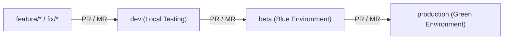

# Design System Monorepo

Turborepo monorepo featuring:

- `apps/admin`: Enterprise Admin Portal built with Remix v2, Vite v8, React 19, Tailwind CSS v4, Web Workers, and strict security hardening. See [apps/admin/README.md](apps/admin/README.md) for full architectural, performance, and security documentation.
- `apps/web`: Remix Framework with Tailwind CSS v4 and the 13-breakpoint Container Query Test Suite.
- `apps/docs`: Vite + React documentation application.
- `packages/ui`: Shared pure stateless Atomic Design System atoms, molecules, and organisms.
- `packages/eslint-config`: Shared ESLint configurations.
- `packages/typescript-config`: Shared TypeScript configurations.

---

## 🛠️ Monorepo Quick Start

```bash
# Install dependencies
pnpm install

# Run all apps in development mode
pnpm run dev

# Run type-checks across all workspaces
pnpm run check-types

# Run linting across all workspaces
pnpm run lint

# Build all packages and applications
pnpm run build

# Run end-to-end tests
pnpm run test:e2e
```

---

## 🔒 Security & Performance Highlights (Admin Portal)

- **Strict Security Headers**: Injects Content-Security-Policy (CSP), COOP (`same-origin`), HSTS, `X-Frame-Options: DENY`, and `X-Content-Type-Options: nosniff`.
- **Session Hardening**: Cryptographically signed `httpOnly`, `sameSite: "lax"`, and mandatory production secret validations.
- **High Performance**: Streaming SSR (`defer()`), DOM virtualization (`@tanstack/react-virtual`), code-splitting, and Web Worker offloading for computationally intensive tasks.

---

## 🌿 Git Branching & Environment Workflow

This project follows an environment-based 3-tier branch architecture:

- **`dev`** (`Local Testing & Development`): Where developers test locally and feature branches merge.
- **`beta`** (`Blue Environment`): Staging & pre-production validation.
- **`production`** (`Green Environment`): Live production release.

Direct pushes to `dev`, `beta`, and `production` branches are **strictly forbidden** and automatically blocked by git pre-push hooks.

### Promotion Pipeline:



### Standard Developer Workflow:

1. Ensure your local `dev` branch is up to date:
   ```bash
   git checkout dev
   git pull origin dev
   ```
2. Create and checkout a new feature or task branch:
   ```bash
   git checkout -b feature/<feature-name>
   # or
   git checkout -b fix/<fix-name>
   ```
3. Make changes, test locally, and commit:
   ```bash
   git commit -m "feat: your change summary"
   ```
4. Push your feature branch to remote:
   ```bash
   git push -u origin feature/<feature-name>
   ```
5. Open a **Pull Request (PR)** or **Merge Request (MR)** targeting the `dev` branch.
6. After approval and local/CI validation on `dev`, merge to **`beta` (Blue)** for staging, and finally to **`production` (Green)**.

### 🛡️ Server-Side & Multi-Tool Protection

All interfaces (Terminal, VS Code, GitHub Desktop, GitKraken, and GitHub.com) are governed by multi-tier protection:

- **Local Pre-Push Hook**: Automatically blocks direct code pushes and branch deletion attempts across all local GUI and CLI tools.
- **VS Code Configuration (`.vscode/settings.json`)**: Prevents forced pushes and enforces synchronization confirmations.
- **GitHub Server-Side Rules**: Configured in GitHub Repository Settings (`Settings -> Branches -> Branch protection rules`) for `dev`, `beta`, and `production`:
  - `Require a pull request before merging` (no direct pushes)
  - `Allow deletions` unchecked (blocks deletion on GitHub web and API)
  - `Allow force pushes` unchecked
  - `Do not allow bypassing the above settings` enabled
